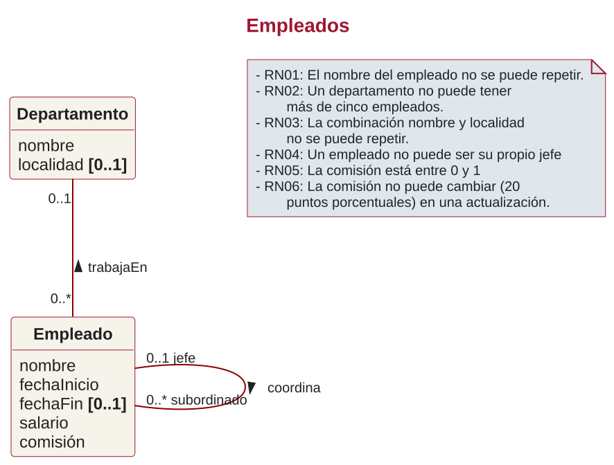
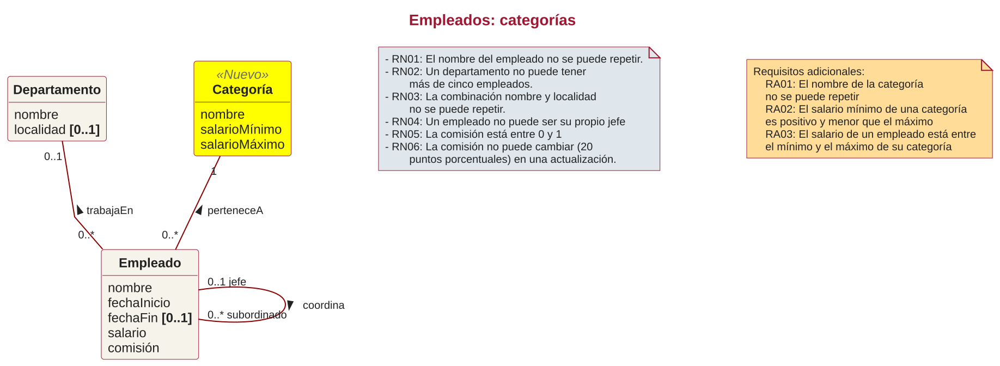

# IISSI-1: Empleados

Código base del ejercicio [Empleados](https://iissi-us.github.io/iissi1/ejercicios/req2sql/5_Empleados/)
de IISSI-1 (requisitos, modelos y solución de la parte base), para resolver «Para trabajar más».

## Cómo empezar

1. **Fork**: con la sesión iniciada en GitHub, pulsa **Fork** (arriba a la derecha de esta página) y
   después **Create fork**. Se crea una copia del repositorio en tu cuenta
   (`https://github.com/<usuario>/IISSI1-Empleados`), que es la tuya: en ella trabajas y subes
   tus cambios.
2. **Clonar**: descarga tu copia (la de tu cuenta, no esta) en tu ordenador:

   ```bash
   git clone https://github.com/<usuario>/IISSI1-Empleados.git
   cd IISSI1-Empleados
   ```

   En VS Code también se puede hacer con **Clone Git Repository…** (`Ctrl+Shift+P` → *Git: Clone*)
   y la URL de tu fork.
3. **Cargar la base de datos** (`employees_db`) desde la carpeta del repositorio:

   ```bash
   mariadb < load_db.sql
   ```

4. **Trabajar**: añade tu solución en ficheros nuevos y súbela a tu fork:

   ```bash
   git add .
   git commit -m "Dar de baja a un empleado"
   git push
   ```

| Fichero | Contenido |
|---|---|
| `create_db.sql` | Script para crear la BD de Empleados |
| `functions.sql` | Funciones de employees_db (f_avg_fee, con un procedimiento que la usa) |
| `load_db.sql` | Carga la BD de Empleados (esquema, rutinas, triggers y datos) |
| `populate_db.sql` | Script para la carga inicial de datos de Empleados |
| `procedures.sql` | Procedimientos de employees_db |
| `queries.sql` | Consultas SQL de Empleados (las del tema 10, en el mismo orden) (`mariadb < queries.sql`) |
| `tests.sql` | Tests negativos para la BD de Empleados (`mariadb < tests.sql`) |
| `triggers.sql` | Triggers de employees_db |



# Para trabajar más

## Dar de baja a un empleado

Implementa un procedimiento `p_end_contract` que ponga la fecha de fin del
contrato de un empleado y asigne sus subordinados activos a su jefe. Debe
rechazar empleados que ya hayan terminado y deshacer todos los cambios si
alguno falla. Implementa también una función `f_num_subordinates` que devuelva
el número de subordinados activos de un empleado.

## Subir los salarios de un departamento

Implementa un procedimiento `p_raise_department_salaries` que suba un
porcentaje (mayor que 0 y como mucho 10) el salario de los empleados activos de
un departamento, y que rechace los departamentos sin empleados activos.
Implementa una función `f_seniority` que devuelva los años de antigüedad de un
empleado y úsala en una consulta que ordene a los empleados por antigüedad.

## Añadir categorías profesionales

Amplía los modelos para representar las categorías profesionales y cumplir las
restricciones RA01–RA03 del diagrama. Actualiza el modelo relacional, el
esquema, el populate y las pruebas negativas.


